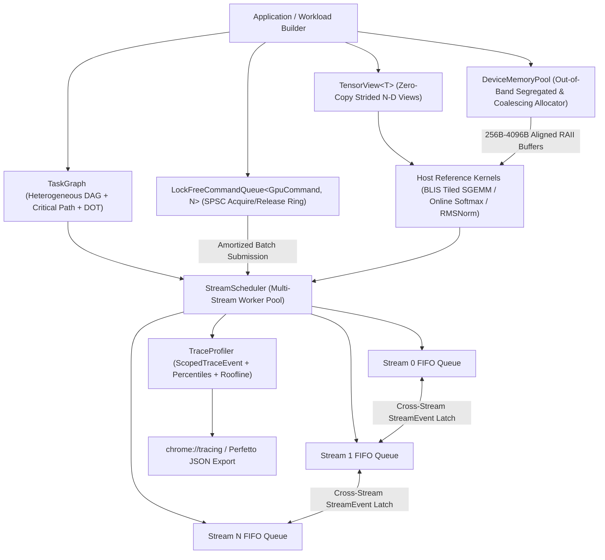

# gpu-runtime-cpp

A zero-dependency, Modern **C++20** host-side GPU runtime and heterogeneous systems library. Designed to demonstrate production-grade host-side runtime engineering: out-of-band aligned device/pinned memory pooling, cache-line-isolated lock-free command submission, deadlock-free multi-stream DAG scheduling with cross-stream event synchronization, zero-copy strided tensor views with BLIS-style cache-blocked host reference kernels, and Perfetto / Chrome Trace profiling.

- **Pure C++20 STL** — zero third-party dependencies.
- **Strict compilation** — builds cleanly under GCC and Clang with `-Wall -Wextra -Wpedantic -Werror` (and MSVC `/W4 /WX`).
- **Sanitizer-first CI** — verified with AddressSanitizer (`ASan`) + UndefinedBehaviorSanitizer (`UBSan`) on every push.

---

## Architecture Overview



---

## Subsystems & Engineering Rationale

### 1. Out-of-Band Aligned Memory Pool (`include/gpuruntime/memory_pool.hpp`)
GPU device buffers and pinned host staging buffers cannot store intrusive allocator headers inside device address space and require strict alignment (256 B default GPU buffer alignment, up to 4096 B page alignment).

- **Host-side metadata**: Block descriptors live strictly out-of-band on the host while backing storage is allocated once at `4096 B` base alignment via aligned `::operator new`.
- **O(1) fast path + best-fit fallback**: Free blocks are indexed into 32 power-of-two size-class bins tracked by a `uint32_t` occupancy bitmask. C++20 `std::countr_zero` locates the lowest sufficient bin in O(1), falling back to intra-bin/higher-bin best-fit scanning when stricter alignment padding is requested.
- **O(1) bidirectional coalescing**: Every block maintains physical address-order neighbor pointers (`prev_phys` / `next_phys`). Prefix alignment padding and trailing remainders split cleanly and merge back to 100% contiguous capacity on deallocation.
- **RAII & Telemetry**: Move-only `PooledAllocation` (`BufferHandle`) guarantees leak-free release; `PoolStats` exposes occupancy, peak watermark, fragmentation ratio, coalesce count, and fast-path cache hit rate.

### 2. Lock-Free SPSC Command Ring Buffer (`include/gpuruntime/ring_buffer.hpp`)
Host-to-GPU submission queues sit directly on the launch-latency critical path.

- **Power-of-two capacity** enforced at compile time via `static_assert`, using monotonically increasing unsigned indices with bitmask indexing so all `Capacity` slots are usable without a sentinel slot.
- **False-sharing elimination**: Producer (`head_`, `cached_tail_`), consumer (`tail_`, `cached_head_`), and ring storage reside on separate `alignas(64)` cache lines. Thread-local shadow cursors avoid unnecessary cross-core cache-line invalidations until the local bound is reached.
- **Explicit acquire/release semantics**: Relaxed loads on thread-owned cursors paired with `memory_order_acquire` / `memory_order_release` handshakes guarantee visibility of in-place `std::construct_at` / `std::destroy_at` slot operations.
- **Batch submission**: `try_push_batch` and `try_pop_batch` amortize atomic release barriers across multi-command bursts of 64-byte `GpuCommand` packets.

### 3. Heterogeneous DAG Task Graph & Multi-Stream Scheduler (`include/gpuruntime/task_graph.hpp`)
Models asynchronous multi-stream execution across compute kernels, H2D/D2H DMA transfers, and host callbacks.

- **Validation & analysis**: Kahn's topological sort detects directed cycles (throwing `CycleDetectedError`), computes parallelizable waves (`levelize()`), runs weighted longest-path DP (`critical_path()`), and exports styled Graphviz DOT (`to_dot()`).
- **Deadlock-free multi-stream dispatch**: `StreamScheduler` maintains one persistent FIFO worker thread per virtual stream and synchronizes cross-stream dependencies via `StreamEvent` latches (lock-free atomic fast path + mutex/CV fallback). Enqueuing tasks onto stream queues strictly in topological order guarantees that the union of DAG edges and intra-stream FIFO edges strictly increases topological rank—making deadlock impossible.
- **Exception safety**: Task exceptions are captured via `std::exception_ptr`, abort downstream work cleanly, and still signal downstream events so waiting streams never hang.

### 4. Zero-Copy Strided `TensorView<T>` & Host Reference Kernels (`include/gpuruntime/tensor_view.hpp`, `include/gpuruntime/kernels.hpp`)
- **`TensorView<T>`**: Arbitrary-rank non-owning view with shape/stride metadata, zero-copy `slice()` (including step > 1), `transpose()`, `permute()`, contiguity-checked `reshape()` (rejecting non-contiguous views without silent copies), and NumPy-compatible right-aligned `broadcast_shape()` / stride-0 `broadcast_to()`.
- **Cache-blocked L1/L2 tiled SGEMM**: BLIS-style 5-loop nest (`MC=64`, `KC=128`, `NC=256`) with `4x8` register-blocked micro-kernel and tile packing (handling transposed/strided inputs and arbitrary non-tile-multiple shapes). Automatically uses AVX2/FMA intrinsics when compiled with `-mavx2` / `-DENABLE_NATIVE_SIMD=ON`, with a clean portable scalar fallback.
- **Online Softmax & RMSNorm**: Single-pass running-max/running-normalizer online softmax (Milakov & Gimelshein, 2018) immune to `exp()` overflow on extreme logits, plus FP64-accumulated RMSNorm.

### 5. Scoped Profiler & Chrome Trace Export (`include/gpuruntime/profiler.hpp`)
- Thread-safe `TraceProfiler` and RAII `ScopedTraceEvent` using `std::chrono::steady_clock`.
- Computes per-event latency distributions (`count`, `min`, `mean`, `p50`, `p95`, `p99`, `max`) and roofline metrics (`GFLOP/s`, `GB/s`, arithmetic intensity).
- Exports standard `chrome://tracing` / [Perfetto UI](https://ui.perfetto.dev) JSON (`ph: "X"` complete events with per-stream `tid`s and roofline `args`).

---

## Project Layout

```text
gpu-runtime-cpp/
├── CMakeLists.txt
├── .github/workflows/ci.yml
├── include/gpuruntime/
│   ├── memory_pool.hpp     # Segregated & coalescing aligned memory pool
│   ├── ring_buffer.hpp     # Lock-free SPSC command submission ring buffer
│   ├── task_graph.hpp      # Heterogeneous DAG, critical path, multi-stream scheduler
│   ├── tensor_view.hpp     # Zero-copy N-D strided tensor view
│   ├── kernels.hpp         # Cache-blocked SGEMM, online softmax, RMSNorm
│   └── profiler.hpp        # Scoped trace profiler & Chrome Trace JSON export
├── src/
│   ├── memory_pool.cpp
│   ├── task_graph.cpp
│   ├── kernels.cpp
│   ├── profiler.cpp
│   └── bench_main.cpp      # CLI benchmark suite + trace.json generator
└── tests/
    ├── test_common.hpp
    ├── test_main.cpp
    ├── test_memory_pool.cpp
    ├── test_ring_buffer.cpp
    ├── test_task_graph.cpp
    └── test_tensor_kernels.cpp
```

---

## Building, Testing & Benchmarking

### Release Build + Unit Test Suite
```bash
cmake -S . -B build -DCMAKE_BUILD_TYPE=Release
cmake --build build --parallel
ctest --test-dir build --output-on-failure --verbose
```

### Enabling Native Host SIMD (AVX2 / FMA)
```bash
cmake -S . -B build-avx2 -DCMAKE_BUILD_TYPE=Release -DENABLE_NATIVE_SIMD=ON
cmake --build build-avx2 --parallel
ctest --test-dir build-avx2 --output-on-failure
```

### Debug Build with AddressSanitizer & UndefinedBehaviorSanitizer
```bash
cmake -S . -B build-san -DCMAKE_BUILD_TYPE=Debug -DENABLE_SANITIZERS=ON
cmake --build build-san --parallel
ASAN_OPTIONS=detect_leaks=1:halt_on_error=1 \
UBSAN_OPTIONS=print_stacktrace=1:halt_on_error=1 \
ctest --test-dir build-san --output-on-failure --verbose
```

### Running the Benchmark CLI & Inspecting Traces
```bash
# Quick smoke benchmark (CI-friendly)
./build/gpuruntime_bench --quick --trace build/trace.json

# Full host runtime benchmark
./build/gpuruntime_bench --trace trace.json
```
Open the generated `trace.json` in `chrome://tracing` or [Perfetto UI](https://ui.perfetto.dev) to inspect multi-stream overlap, DMA/compute timelines, and per-event roofline annotations.

---

## License

MIT License — see [LICENSE](LICENSE).
